# Deep Knowledge Context Tracker




Solves the **"context evaporation"** problem in legacy codebases: when an AI agent (or a new developer) touches code that was fixed months ago, all the hard-won reasoning — the constraints discovered, the approaches that failed, the exact "why" — is gone.

This system captures that reasoning at commit time, stores it in a NoSQL key-value store, and links it directly to Git commits via a unique hash. Any future agent or developer can retrieve the full context in one O(1) lookup.

---

## How It Works

```
Developer / AI agent makes a change
        │
        ▼
preserve_deep_knowledge  ──►  POST /api/v1/knowledge  ──►  tally_ai_store.json
        │                              │
        │                         ctx-hash
        │
        ▼
Git commit message (last line):
  Deep-Knowledge-Key: ctx-8589f5485964
        │
        ▼
Later: fetch_knowledge(ctx_hash)
  git blame → git log → parse key → GET /api/v1/knowledge/ctx-xxx
        │
        ▼
Full context returned to Cline's context window
```

---

## Project Structure

```
deep-knowledge/
│
├── .clinerules                    # AI agent rules (mandatory workflow)
├── .gitignore
├── README.md                      # This file
│
├── knowledge-server/              # FastAPI backend (NoSQL store)
│   ├── server.py                  # REST API on port 8000
│   └── tally_ai_store.json        # Runtime store (auto-created, gitignored)
│
├── cli-tools/                     # Manual / CI CLI tools
│   ├── preserve_deep_knowledge.py # Capture tool (POST to API)
│   └── get_deep_knowledge.py      # Retrieval tool (git blame → GET API)
│
└── mcp-server/                    # Cline MCP integration (recommended)
    ├── mcp_server.py              # MCP server (FastMCP, stdio transport)
    └── README.md                  # MCP setup & usage guide
```

---

## Quick Start

### Option A — Use via Cline (MCP, recommended)

1. **Install dependencies:**
   ```bash
   pip install -r requirements.txt
   ```

2. **Start the knowledge server:**
   ```bash
   python knowledge-server/server.py
   ```

3. **Restart VS Code** — Cline auto-starts the MCP server and the tools
   `preserve_deep_knowledge` and `fetch_knowledge` become available immediately.

4. **Use in Cline:**
   - Before committing: *"Preserve deep knowledge for TPR-48892..."*
   - Before editing: *"Fetch knowledge for the ctx-hash in this commit"*

See [`mcp-server/README.md`](mcp-server/README.md) for full usage details.

---

### Option B — Use via CLI (manual / CI)

1. **Install dependencies:**
   ```bash
   pip install -r requirements.txt
   ```

2. **Start the knowledge server:**
   ```bash
   python knowledge-server/server.py
   ```

3. **Capture knowledge:**
   ```bash
   python cli-tools/preserve_deep_knowledge.py \
     --tickets TPR-48892 \
     --context '{"tickets": {"TPR-48892": {"focus": "...", "discovered_constraints": [...], "discarded_approaches": [...], "final_solution": "..."}}}'
   # Output: Deep-Knowledge-Key: ctx-8589f5485964
   ```

4. **Retrieve knowledge:**
   ```bash
   python cli-tools/get_deep_knowledge.py --file ledger_model.cpp --line 21
   ```

---

## MCP Tool Reference

### `preserve_deep_knowledge`

Captures architectural reasoning for one or more Jira tickets and stores it in the knowledge server.

**Parameters:**

| Parameter | Type | Required | Description |
|-----------|------|----------|-------------|
| `tickets` | `list[str]` | ✅ | List of Jira ticket IDs, e.g. `["TPR-48892"]` or `["[TPR-48892]", "TPR-12345"]` |
| `focus` | `str` | ✅ | One-line description of what this change fixes or implements |
| `discovered_constraints` | `list[str]` | ✅ | Constraints discovered during investigation (legacy rules, hidden deps, etc.) |
| `discarded_approaches` | `list[str]` | ✅ | Approaches tried and rejected, with reasons |
| `final_solution` | `str` | ✅ | Precise description of the solution implemented |

**Returns:** A line to append as the absolute last line of the Git commit message:
```
Deep-Knowledge-Key: ctx-<hash>
```

---

### `fetch_knowledge`

Fetches and returns the stored architectural knowledge document for a given `Deep-Knowledge-Key`.

> **Note:** This tool only performs the HTTP lookup. The caller (Cline) is responsible for running `git blame` and `git log` via `execute_command` to extract the `ctx-hash` from the commit message **before** calling this tool.

**Parameters:**

| Parameter | Type | Required | Description |
|-----------|------|----------|-------------|
| `ctx_hash` | `str` | ✅ | The `Deep-Knowledge-Key` value extracted from the commit message, e.g. `"ctx-a86482cc3ed6"`. The `"ctx-"` prefix is required. |

**Pre-call workflow (Cline runs these steps via `execute_command`):**

1. **git blame** — identify the commit that last touched the line:
   ```bash
   git -C <repo_dir> blame --porcelain -L <line>,<line> -- <file_path>
   ```
   Extract the 40-character commit hash from the **first token** of the output.

2. **git log** — read the full commit message:
   ```bash
   git -C <repo_dir> log -1 --format="%B" <commit_hash>
   ```

3. **Extract the key** — search the commit message with the regex:
   ```
   Deep-Knowledge-Key: (ctx-[a-zA-Z0-9]+)
   ```
   If no key is found, there is no stored knowledge for this commit — proceed normally.

4. **Call `fetch_knowledge`** with the extracted key.

**Returns:** The full knowledge document as formatted Markdown:

```markdown
# Knowledge Document: ctx-<hash>

## Ticket: TPR-XXXXX

**Focus:** <one-line description>

**Discovered Constraints:**
- <constraint 1>
- <constraint 2>

**Discarded Approaches:**
- <approach tried and rejected, with reason>

**Final Solution:** <precise description of the solution implemented>
```

Returns an error message (`No knowledge document found for key: ctx-xxx`) if no document exists for the given key.

---

## Commit Message Format

The `Deep-Knowledge-Key` must always be the **absolute last line** of the commit message:

```
[TPR-48892] - Fix refresh issue in GCC vat applicability for expense ledger

Refresh issue in GCC vat applicability in OTG Expense ledger is fixed.
Condition for "create with GSTIN" is corrected.

Signed-off-by: Bala Krishna R <bala.krishna@tallysolutions.com>
Deep-Knowledge-Key: ctx-8589f5485964
```

**Rules:**
- No trailing newline after the key line
- No text after the key line
- Key must come after `Signed-off-by:` (if present)
- Ticket ID in subject must use bracketed format: `[TPR-XXXXX]`

---

## Knowledge Document Schema

```json
{
  "timestamp": "2026-04-21T10:30:00Z",
  "tickets": {
    "TPR-48892": {
      "focus": "Fix refresh issue in GCC vat applicability for OTG expense ledger",
      "discovered_constraints": [
        "Legacy GSTIN creation condition was bypassing the state check."
      ],
      "discarded_approaches": [
        "Forcing UI refresh caused infinite loop in legacy UI wrapper."
      ],
      "final_solution": "Corrected the create with GSTIN boolean condition directly in the ledger data model."
    }
  }
}
```

---

## API Reference

| Method | Endpoint | Description |
|--------|----------|-------------|
| `POST` | `/api/v1/knowledge` | Store a knowledge document, returns `{"hash": "ctx-xxx"}` |
| `GET` | `/api/v1/knowledge/{hash}` | O(1) retrieval of a knowledge document |

Interactive docs available at `http://localhost:8000/docs` when the server is running.

---

## Design Principles

- **Pure NoSQL key-value** — flat JSON dict, O(1) lookup by exact `ctx-hash`
- **No vector databases** — no Pinecone, Weaviate, Chroma, or similar
- **No embeddings or semantic search** — retrieval is always exact
- **No RAG frameworks** — the hash in the commit message IS the index
- **Deterministic** — same payload + timestamp always produces the same hash